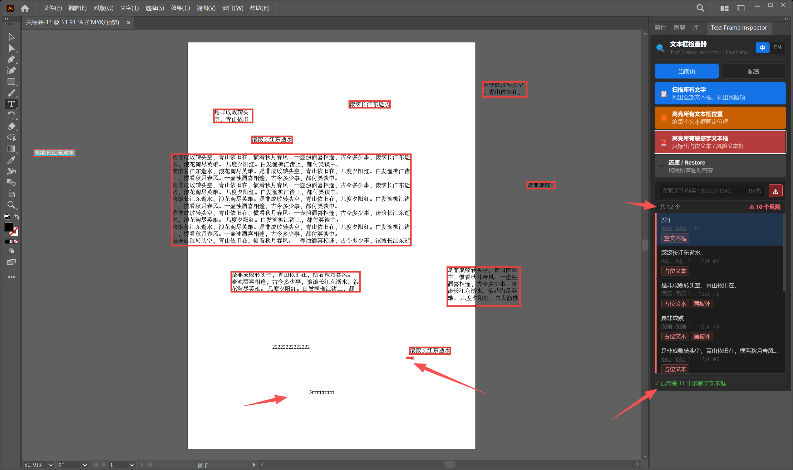
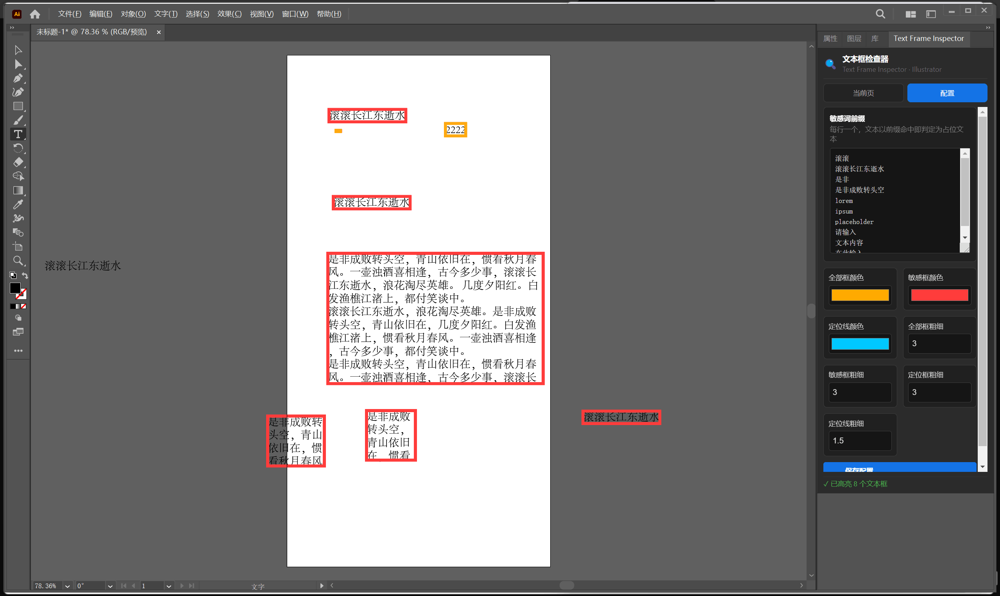

# Text Frame Inspector

[中文](README.md) | [English](README_en.md)

Text Frame Inspector 是一个 Adobe Illustrator CEP 面板插件，用于在交付、印刷或导出前检查文档里的隐藏文本框、占位文本和异常文本对象。它会扫描当前文档中的所有文本框，标记疑似占位内容，在画板上绘制临时定位框，并支持从结果列表跳转到对应对象。

当前版本：`1.0.0`

## 这个插件是做什么的

这个插件面向 Illustrator 文件的交付前检查。很多文本框肉眼不容易看到，但仍然可能影响印刷、导出、审稿或最终交付质量。Text Frame Inspector 的目标就是把这些对象找出来，并让用户能快速定位。

默认检查项：

- 中文占位文本前缀，例如 `滚滚长江东逝水` 和 `是非成败转头空`
- 英文占位文本前缀，例如 `lorem ipsum`、`placeholder`、`dummy text`、`sample text`、`the quick brown fox`、`your text here`、`text goes here`
- 空文本框
- 极小字号文本
- 隐藏图层上的文本框
- 完全透明的文本框
- 位于当前画板外的文本框

主要功能：

- 扫描当前 Illustrator 文档中的所有文本框
- 显示可搜索的结果列表
- 高亮所有文本框位置
- 只高亮敏感字或风险文本框
- 点击列表项后定位到画板中的对应文本框
- 绘制临时定位框和十字坐标线
- 配置敏感词前缀、高亮颜色和线框粗细
- 面板界面支持中文和英文切换，默认中文

主界面用于扫描文本框、搜索列表、只看风险项，并在 Illustrator 画板中定位问题文本框：



配置页用于修改敏感词前缀、高亮颜色和线框粗细：



兼容性：

- 推荐环境：Adobe Illustrator 2023 及以上
- Manifest 支持：Illustrator 2020 及以上，host version `ILST [24.0,99.9]`
- 当前发布包主要面向 Windows
- 插件类型：CEP 面板

## 用户怎么用，以及基本原理

安装后重启 Illustrator，然后打开：

```text
窗口 > 扩展（旧版） > Text Frame Inspector
```

常用流程：

1. 打开一个 Illustrator 文档。
2. 点击 `扫描所有文字`。
3. 查看下方结果列表。
4. 点击列表里的某一项，插件会在画板中选中并定位到对应文本框。
5. 点击 `高亮所有文本框位置`，给所有文本框绘制临时定位框。
6. 点击 `高亮所有敏感字文本框`，只标出风险文本框。
7. 点击 `还原`，移除所有临时高亮层。

配置方式：

- 打开 `配置` Tab。
- 每行填写一个敏感词前缀。
- 调整颜色和线框粗细。
- 点击 `保存配置`。

基本原理：

- 面板界面使用 Adobe CEP，前端由 HTML、CSS 和 JavaScript 实现。
- 面板通过 `CSInterface.evalScript` 调用 Illustrator 内部脚本。
- Illustrator 侧逻辑写在 `jsx/host.jsx`，运行环境是 ExtendScript。
- 脚本读取 `app.activeDocument.textFrames`，分析每个文本框后把 JSON 结果返回给面板。
- 高亮效果画在临时图层 `__TextFrameInspector__` 上。
- `还原` 会删除这个临时图层，正常情况下不会修改原始 artwork。

## 开发与打包

项目结构：

```text
TextFrameInspector/
  CSXS/manifest.xml
  css/style.css
  js/CSInterface.js
  js/main.js
  jsx/host.jsx
  index.html
  installer/TextFrameInspector.iss
  scripts/build-release.ps1
  scripts/build-exe.ps1
  scripts/build-zxp.ps1
  .github/workflows/release.yml
```

本地开发安装路径：

```text
C:\Users\<username>\AppData\Roaming\Adobe\CEP\extensions\TextFrameInspector
```

如果未签名扩展不显示，可以开启 CEP 调试模式：

```powershell
reg add "HKCU\Software\Adobe\CSXS.9" /v PlayerDebugMode /t REG_SZ /d 1 /f
reg add "HKCU\Software\Adobe\CSXS.10" /v PlayerDebugMode /t REG_SZ /d 1 /f
reg add "HKCU\Software\Adobe\CSXS.11" /v PlayerDebugMode /t REG_SZ /d 1 /f
```

本地构建 ZIP：

```powershell
powershell -ExecutionPolicy Bypass -File .\scripts\build-release.ps1 -Version 1.0.0
```

本地构建 EXE：

```powershell
powershell -ExecutionPolicy Bypass -File .\scripts\build-exe.ps1 -Version 1.0.0
```

需要本机安装 Inno Setup Compiler，也就是 `ISCC.exe`。

本地构建 ZXP：

```powershell
powershell -ExecutionPolicy Bypass -File .\scripts\build-zxp.ps1 -Version 1.0.0
```

需要本机安装 Adobe `ZXPSignCmd`。

发布自动化（如何触发 GitHub Actions）：

本项目配置了 GitHub Actions 自动发版流程。普通 `git push origin main` 只会上传代码，不会触发 Release 打包。只有推送 `v` 开头的标签（Tag），例如 `v1.0.0`，才会触发云端打包，并在仓库的 **Releases** 页面发布安装包。

标准发版步骤：

1. 先提交并推送代码：
   ```powershell
   git add .
   git commit -m "Release v1.0.0"
   git push origin main
   ```
2. 添加版本标签：
   ```powershell
   git tag v1.0.0
   ```
3. 推送标签到 GitHub：
   ```powershell
   git push origin v1.0.0
   ```

推送成功后：
- 你可以前往 GitHub 仓库页面的 **Actions** 标签夹，查看打包进度。
- 等待几分钟运行结束后，前往仓库首页右侧的 **Releases** 即可下载生成的三个最终产物：
  - `TextFrameInspector-<version>.zxp`（供 Adobe 插件市场或 ZXPInstaller 使用）
  - `TextFrameInspector-Setup-<version>.exe`（供 Windows 用户双击安装使用）
  - `TextFrameInspector-<version>.zip`（绿色解压版供备用）

如果没有触发 Actions，优先检查：

- 是否只执行了 `git push origin main`，但没有执行 `git push origin v1.0.0`
- tag 名是否以小写 `v` 开头，例如 `v1.0.0`
- GitHub 仓库的 **Actions** 功能是否已启用
- `.github/workflows/release.yml` 是否已经提交到 GitHub
- 同一个 tag 是否已经推送过；如果要重发，建议使用新的版本号，例如 `v1.0.1`

如果必须删除并重发同一个 tag：

```powershell
git tag -d v1.0.0
git push origin :refs/tags/v1.0.0
git tag v1.0.0
git push origin v1.0.0
```

打包策略：

- `zip` 是最简单的备用分发格式。
- `exe` 适合面向 Windows 用户直接分发。
- `zxp` 是 CEP 扩展更正式的插件包格式，适合 Adobe 生态分发流程。


## 社区

[LINUX DO](https://linux.do/)

## 开源协议

本项目基于 [MIT](LICENSE) 协议开源。
