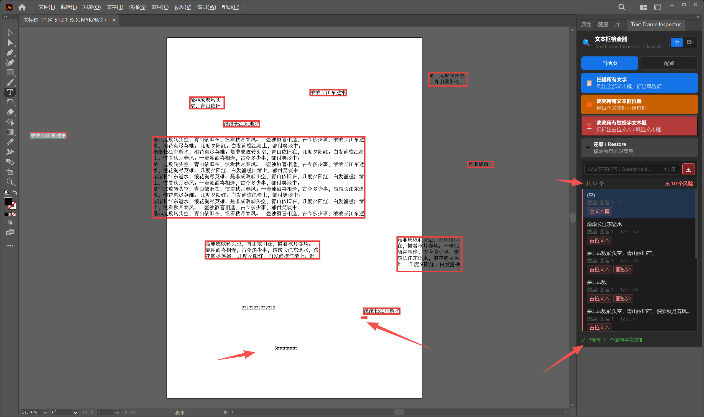
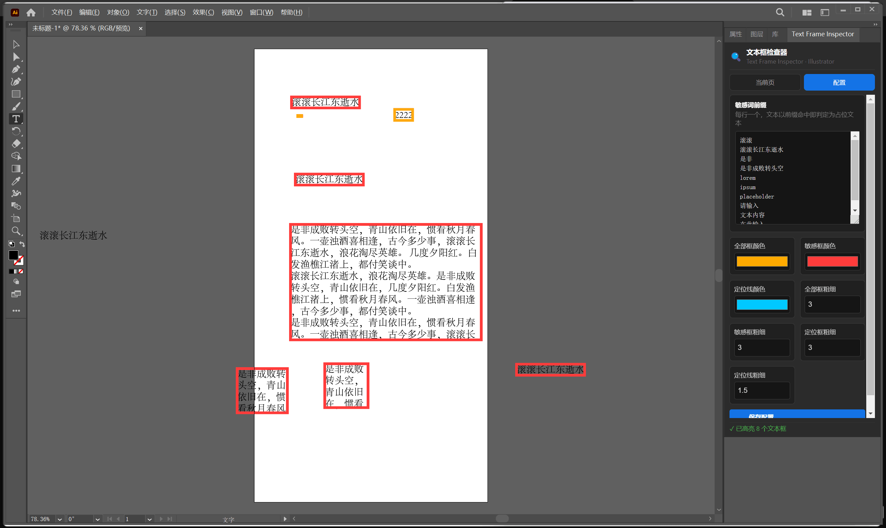

# Text Frame Inspector

[中文](README.md) | [English](README_en.md)

Text Frame Inspector is an Adobe Illustrator panel for finding hidden, risky, or forgotten text frames before delivery, print, or export. It scans every text frame in the active document, flags placeholder-style copy, draws temporary position highlights on the artboard, and lets users jump from a result list to the matching object.

Current version: `1.0.0`

## What It Does

Text Frame Inspector is built for production checks in Illustrator files. It helps catch text objects that are easy to miss visually but can still affect print, export, review, or final delivery quality.

Core checks:

- Chinese placeholder prefixes such as `滚滚长江东逝水` and `是非成败转头空`
- English placeholder prefixes such as `lorem ipsum`, `placeholder`, `dummy text`, `sample text`, `the quick brown fox`, `your text here`, and `text goes here`
- Empty text frames
- Extremely small text
- Text frames on hidden layers
- Fully transparent text frames
- Text frames outside the active artboard

Main features:

- Scan all text frames in the active Illustrator document
- Show a searchable result list
- Highlight all text frame positions
- Highlight only risky or placeholder text frames
- Click a result item to locate it on the artboard
- Draw temporary position boxes and crosshair guide lines
- Configure sensitive prefixes, highlight colors, and stroke widths
- Switch the panel UI between Chinese and English

The main panel is used to scan text frames, search results, filter risky items, and locate matching text frames on the Illustrator artboard:



The settings panel is used to configure sensitive prefixes, highlight colors, and stroke widths:



Compatibility:

- Recommended: Adobe Illustrator 2023 and newer
- Supported by manifest: Illustrator 2020 and newer, host version `ILST [24.0,99.9]`
- Platform: Windows-focused release package
- Extension type: CEP panel

## How To Use

Install the plugin, restart Illustrator, then open:

```text
Window > Extensions (Legacy) > Text Frame Inspector
```

Typical workflow:

1. Open an Illustrator document.
2. Click `Scan Text Frames`.
3. Review the result list.
4. Click a result item to select and locate that text frame on the artboard.
5. Use `Highlight All Text Frames` to draw temporary boxes for every text frame.
6. Use `Highlight Risky Text Frames` to draw boxes only around risky text frames.
7. Use `Restore` to remove temporary highlight layers.

Settings:

- Open the `Settings` tab.
- Add one sensitive prefix per line.
- Adjust colors and line widths.
- Click `Save Settings`.

How it works:

- The panel UI runs in Adobe CEP using HTML, CSS, and JavaScript.
- The UI calls Illustrator through `CSInterface.evalScript`.
- Illustrator-side logic runs in `jsx/host.jsx` as ExtendScript.
- The script reads `app.activeDocument.textFrames`, analyzes each text frame, and returns JSON data to the panel.
- Highlighting is drawn on a temporary Illustrator layer named `__TextFrameInspector__`.
- Restore removes that temporary layer and does not intentionally modify original artwork.

## Development And Packaging

Project structure:

```text
TextFrameInspector/
  CSXS/manifest.xml
  css/style.css
  js/CSInterface.js
  js/main.js
  jsx/host.jsx
  index.html
  installer/TextFrameInspector.iss
  scripts/build-release.ps1
  scripts/build-exe.ps1
  scripts/build-zxp.ps1
  .github/workflows/release.yml
```

Local development install path:

```text
C:\Users\<username>\AppData\Roaming\Adobe\CEP\extensions\TextFrameInspector
```

Enable CEP debug mode if unsigned local extensions do not appear:

```powershell
reg add "HKCU\Software\Adobe\CSXS.9" /v PlayerDebugMode /t REG_SZ /d 1 /f
reg add "HKCU\Software\Adobe\CSXS.10" /v PlayerDebugMode /t REG_SZ /d 1 /f
reg add "HKCU\Software\Adobe\CSXS.11" /v PlayerDebugMode /t REG_SZ /d 1 /f
```

Build ZIP locally:

```powershell
powershell -ExecutionPolicy Bypass -File .\scripts\build-release.ps1 -Version 1.0.0
```

Build EXE locally:

```powershell
powershell -ExecutionPolicy Bypass -File .\scripts\build-exe.ps1 -Version 1.0.0
```

Requires Inno Setup Compiler (`ISCC.exe`) in `PATH`.

Build ZXP locally:

```powershell
powershell -ExecutionPolicy Bypass -File .\scripts\build-zxp.ps1 -Version 1.0.0
```

Requires Adobe `ZXPSignCmd` in `PATH`.

Release automation (How to trigger GitHub Actions):

This project is configured with a GitHub Actions auto-release workflow. A normal `git push origin main` only uploads source code and does not trigger the release build. The release workflow only runs when you push a tag starting with `v`, for example `v1.0.0`.

Standard release steps:

1. Commit and push source code first:
   ```powershell
   git add .
   git commit -m "Release v1.0.0"
   git push origin main
   ```
2. Create a version tag:
   ```powershell
   git tag v1.0.0
   ```
3. Push the tag to GitHub:
   ```powershell
   git push origin v1.0.0
   ```

After pushing the tag:
- You can navigate to the **Actions** tab on your GitHub repository to check the build progress.
- Once completed (takes a few minutes), go to the **Releases** section on the right side of the repository codebase to download the generated files:
  - `TextFrameInspector-<version>.zxp` (for Adobe Exchange or ZXPInstaller)
  - `TextFrameInspector-Setup-<version>.exe` (Windows installer)
  - `TextFrameInspector-<version>.zip` (fallback archive)

If Actions does not run, check these first:

- You pushed `main` but did not push the tag with `git push origin v1.0.0`
- The tag name does not start with lowercase `v`
- GitHub Actions is disabled for the repository
- `.github/workflows/release.yml` has not been committed to GitHub
- The same tag was already pushed before; use a new version such as `v1.0.1`

If you must delete and republish the same tag:

```powershell
git tag -d v1.0.0
git push origin :refs/tags/v1.0.0
git tag v1.0.0
git push origin v1.0.0
```

Packaging strategy:

- `zip` is the simplest fallback distribution.
- `exe` is the recommended Windows customer-facing installer.
- `zxp` is the CEP package format for Adobe-oriented distribution workflows.


## 社区

[LINUX DO](https://linux.do/)

## 开源协议

本项目基于 [MIT](LICENSE) 协议开源。
